# 👨‍💻 PENETRATION TESTING REPORT
**PASSWORD CRACKING & HASH EXTRACTION PHASE**

---

W3-PM2 | CYBERSECURITY | NETWORKWALKS

🚥 Project Overview

| **Field**                           | **Detail**                                                                                     |
| ------------------------------------ | ----------------------------------------------------------------------------------------------- |
| **Pentester**                        | **Oyeru Rachael Emalohi**                                                                        |
| **Program/Batch**                    | Networkwalks-B084D                                                                               |
| **Date**                             | 18th–19th November, 2026                                                                          |
| **Modules completed**                | W3-PM2 (Password Cracking with NW Tools)                                                          |
| **Client/Target**                    | My own password-protected lab PDFs, created for this exercise                                     |
| **Permission secured?**              | Yes — self-authorized educational lab on my own files                                             |
| **Phases covered**                   | **Phase 1:** Hash Extraction &nbsp;&nbsp;**Phase 2:** Dictionary/Offline Password Recovery         |

---

# ⛔ 1. Liability Disclaimer

The activities documented in this report were conducted strictly on files created by me, for the sole purpose of this Networkwalks educational lab. No third-party system, account, or data was accessed. The contents of this document are intended strictly for educational and research purposes. The instructor, author, and Networkwalks assume no liability for the misuse or misapplication of this knowledge; all subsequent actions taken by the reader are their sole responsibility. Unauthorized password cracking or account access constitutes a criminal offense in most jurisdictions, regardless of whether data or systems are damaged, and can result in severe legal penalties, significant fines, career impact (employment termination), and a permanent criminal record.

> ⚠️ **Note: Only crack passwords on your own files, or files you have explicit written authorization to test.**

---

# 🔦 2. Introduction

As part of my Networkwalks internship program (week 3), this report documents the process of recovering passwords from three self-created, password-protected PDF files using hash extraction and dictionary-attack techniques. The exercise mirrors a real-world password-auditing workflow: an encrypted file's hash is extracted into a crackable format, then tested against a wordlist until a match is found. This simulates how a penetration tester (or an attacker) recovers a password once they already have the encrypted artifact, and reinforces why weak, dictionary-guessable passwords put encrypted documents at risk.

### 💡 Hash extraction

Performed using the NetworkWalks Hash Calculator and the OnlineHashCrack PDF hash extractor, both of which convert an encrypted PDF into a `pdf2john`/`hashcat`-compatible `$pdf$...` hash.

### 🔎 Cracking activities

Performed using **Johnny**, the graphical front-end for **John the Ripper**, running inside a Kali Linux VM, and using the **NetworkWalks Password Cracker** (an online dictionary-attack lab tool).

### 📝 Methodology, analysis framework, and documentation

To ensure reproducibility and rigorous documentation, every technical step outlines the exact tool used, the hash involved, the result obtained, verification screenshots, and a brief analytical note on the security implications of the recovered password.

---

# 🧰 3. Tools Used

| Tool/commands                  | Purpose                                                                                                    |
| ------------------------------- | ------------------------------------------------------------------------------------------------------------ |
| Kali Linux                     | Operating system used to run John the Ripper / Johnny for local, offline password cracking.                   |
| Windows OS                     | Host operating system used to browse the target PDFs and the NetworkWalks/OnlineHashCrack web tools.            |
| Johnny (John the Ripper GUI)   | Graphical front-end for John the Ripper; loads a password hash and runs an attack against it.                  |
| NetworkWalks Hash Calculator   | Extracts a crackable `$pdf$...` hash (pdf2john/hashcat format) from an encrypted PDF, directly in the browser.  |
| NetworkWalks Password Cracker  | Online dictionary-attack lab; runs a 100-word built-in wordlist against a pasted `$pdf$` hash.                  |
| OnlineHashCrack (PDF Hash Extractor) | Alternative browser-based tool to extract a `pdf2john`/`hashcat`-compatible hash from an encrypted PDF.    |
| HexStrike AI (Kali MCP server) | AI-assisted offensive-security tooling server running inside the Kali VM; used here to confirm the lab environment (server health, John the Ripper version) rather than to perform the cracking itself. |

---

---

⚒️ Activities Performed

---

# 4. Password Recovery — My-Locked-PDF1.pdf

## 4.1. Background

My-Locked-PDF1 (for NW Tools Lab WK3-PM2).pdf is a PDF I password-protected myself for this lab. Opening it in a PDF viewer confirms it is encrypted and prompts for a password before any content can be viewed.

[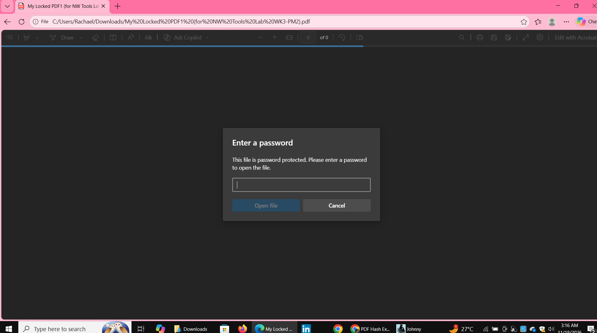](screenshots/pdf1-locked-prompt.png)

## 4.2. Hash Extraction

The PDF was uploaded to the **OnlineHashCrack PDF Hash Extractor**, which parsed the file and returned a crackable `$pdf$` hash in `pdf2john`/`hashcat` format.

> **Hash extracted:** `$pdf$4*4*128*-1060*1*16*55d1a5c14175da449753199e44971d32*32*777fd021a7f3c5ae598c0c6495c7f76e0000000000000000000000000000000*32*ceecdac74b19b5a62688d3b3524e1374c955cbb9cc3c45316494d9446ef81af1`

[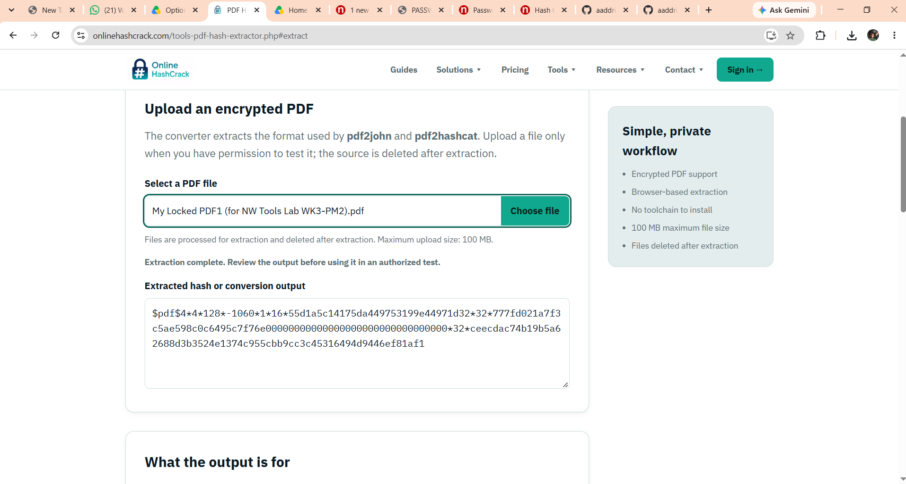](screenshots/pdf1-hash-extraction-onlinehashcrack.png)

## 4.3. Cracking with Johnny (John the Ripper)

The extracted hash was loaded into **Johnny**, and a dictionary attack was run against it.

[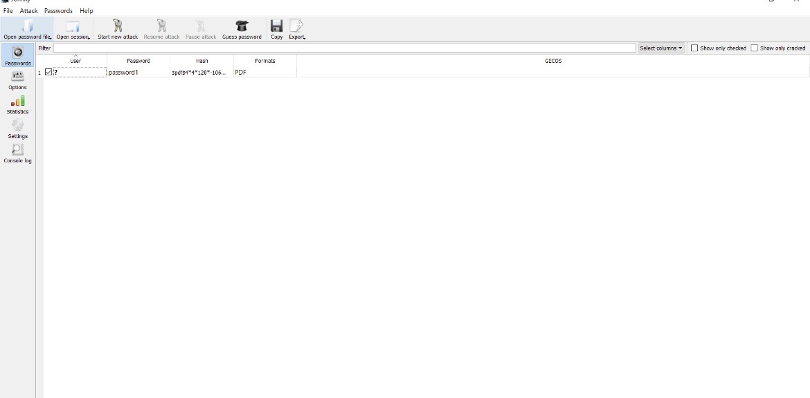](screenshots/pdf1-johnny-hash-loaded.jpeg)

> **Result: password cracked — `password1`** (100%, 1/1 cracked)

[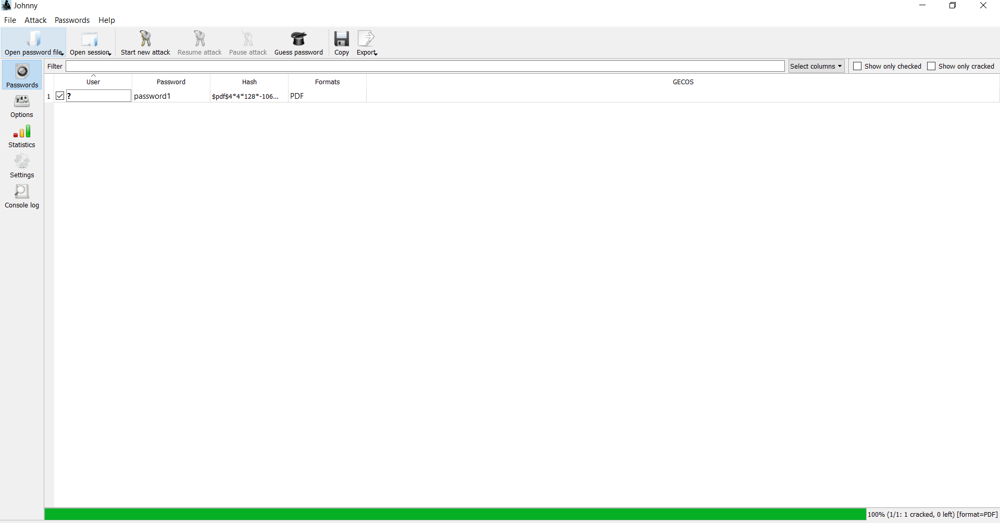](screenshots/pdf1-johnny-cracked-password1.png)

> ⚠️ **Security relevance:** `password1` is one of the most commonly used passwords worldwide and sits near the top of every standard cracking wordlist. A hash protected by a password this weak offers almost no real protection — it can be recovered in seconds on consumer hardware, regardless of the encryption algorithm wrapped around it.

---

# 5. Password Recovery — My-Locked-PDF2.pdf

## 5.1. Background

My-Locked-PDF2.pdf is a second self-created, password-protected PDF used for the same exercise, cracked entirely offline using Johnny.

## 5.2. Cracking with Johnny (John the Ripper)

The attack was started against the PDF's hash with no password checked yet:

[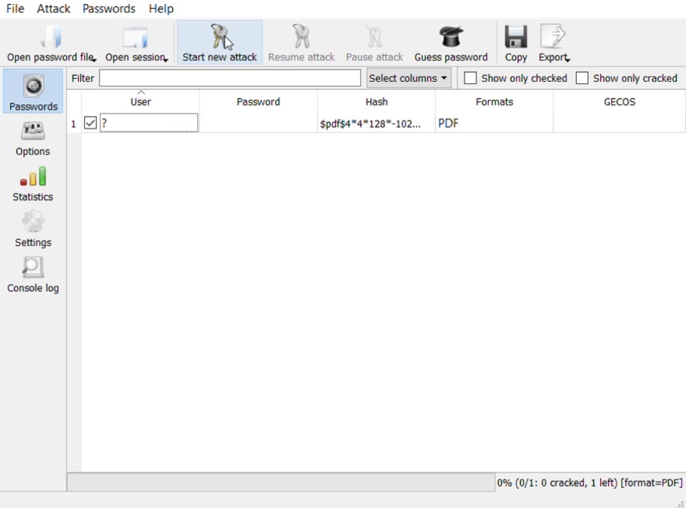](screenshots/pdf2-johnny-attack-start.jpeg)

The wordlist worked through a series of common passwords (e.g. `password1`) before reaching a match:

[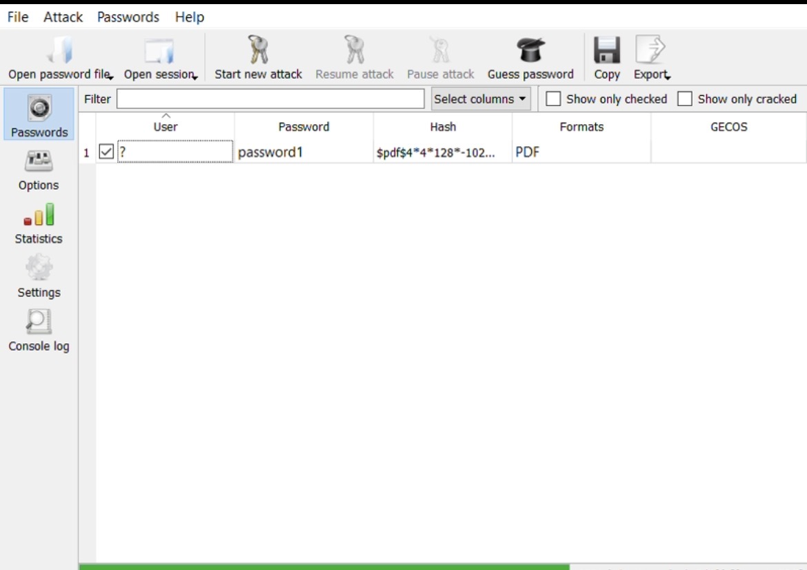](screenshots/pdf2-johnny-attack-progress.jpeg)

> **Result: password cracked — `good-luck`** (100%, 1/1 cracked)

[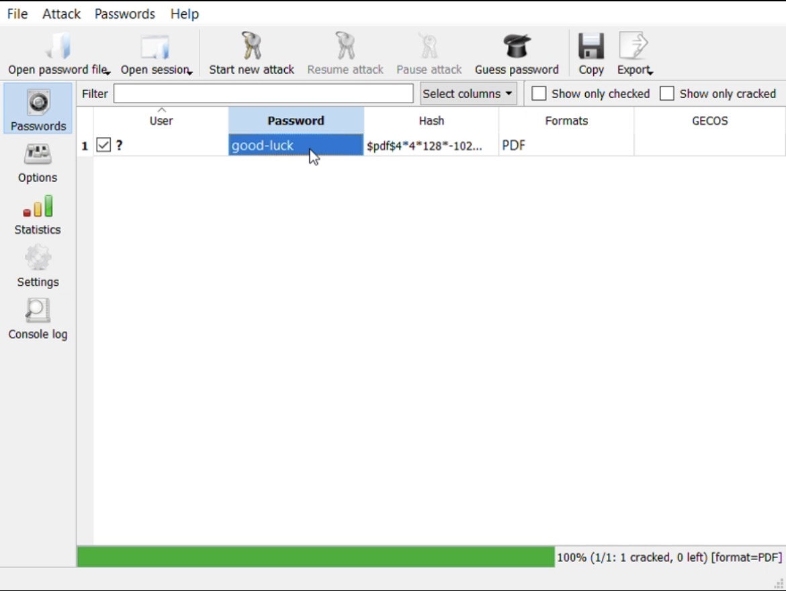](screenshots/pdf2-johnny-cracked-goodluck.jpeg)

Opening the file with the recovered password revealed its content:

> ⚠️ **Security relevance:** `good-luck` is a short, dictionary-based phrase with no numbers, casing, or symbols. Even though it isn't a "top 10" password like `password1`, it's still a plain English phrase — exactly the kind of entry a small, curated wordlist is built to catch. It reinforces the same lesson: memorable phrases are guessable phrases.

---

# 6. Password Recovery & Flag Capture — My-Locked-PDF3.pdf

## 6.1. Hash Extraction

My-Locked-PDF3.pdf was uploaded to the **NetworkWalks Hash Calculator**, which extracted its crackable hash directly in the browser.

[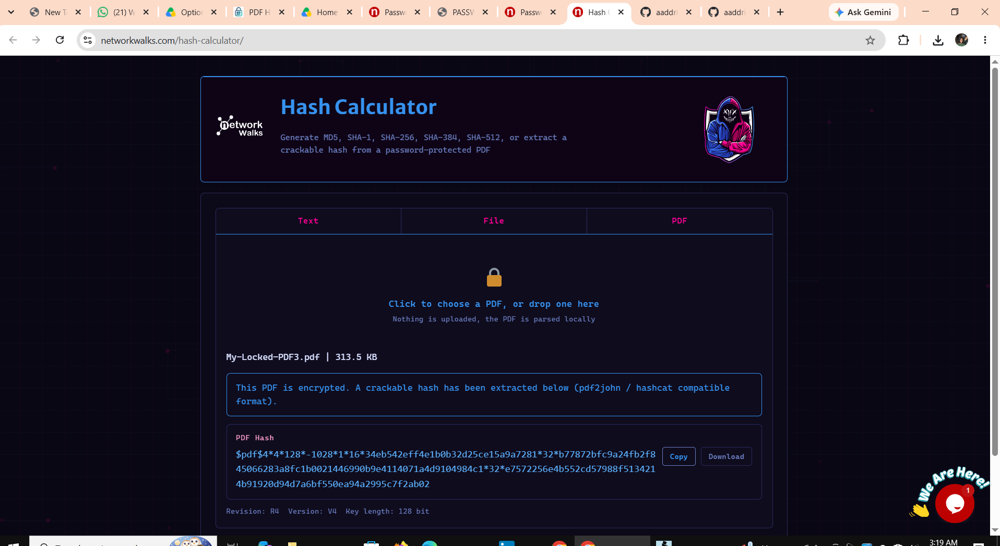](screenshots/pdf3-hash-calculator-extraction.png)

> **Hash extracted:** `$pdf$4*4*128*-1028*1*16*34eb542eff4e1b0b32d25ce15a9a7281*32*b77872bfc9a24fb2f845066283a8fc1b0021446990b9e4114071a4d9104984c1*32*e7572256e4b552cd57988f5134214b91920d94d7a6bf550ea94a2995c7f2ab02`
> Revision: R4 · Version: V4 · Key length: 128-bit

## 6.2. Cracking with the NetworkWalks Password Cracker

The hash was pasted into the **NetworkWalks Password Cracker**, a browser-based dictionary-attack lab that hashes every word in a wordlist and checks it against the target hash — the same idea John the Ripper uses.

[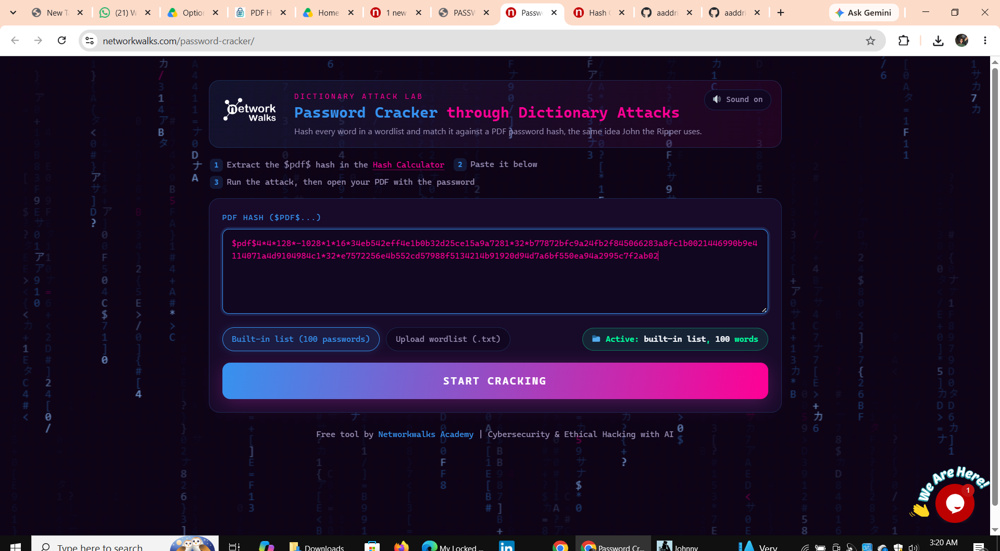](screenshots/pdf3-nw-dictionary-attack-setup.png)

The built-in 100-word list was run against the hash. After 35 attempts (35%, ~4 passwords/second), a match was found:

[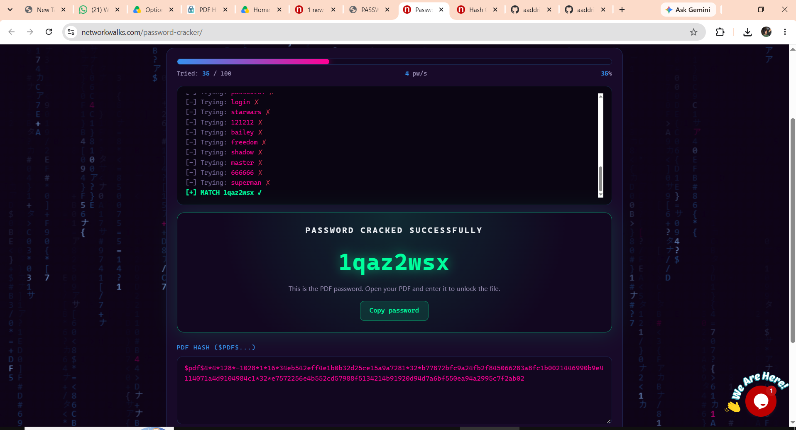](screenshots/pdf3-nw-dictionary-attack-match.png)

> **Result: password cracked — `1qaz2wsx`**

## 6.3. Verification with Johnny (John the Ripper)

The same hash and password were independently verified using Johnny inside the Kali VM:

[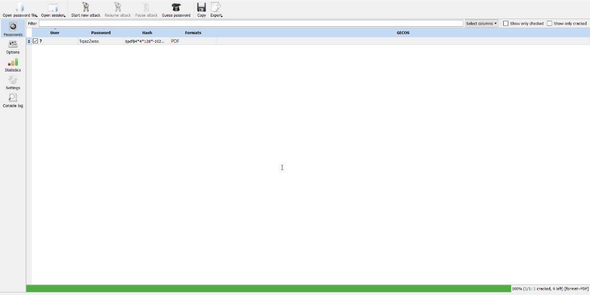](screenshots/pdf3-johnny-cracked-1qaz2wsx.jpeg)

## 6.4. Flag Capture

Opening My-Locked-PDF3.pdf with the recovered password `1qaz2wsx` unlocked the file and revealed the captured flag:

[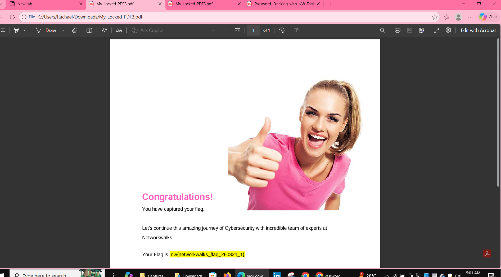](screenshots/pdf3-flag-captured.png)

> **🚩 Flag:** `nw{networkwalks_flag_260821_1}`

> ⚠️ **Security relevance:** `1qaz2wsx` looks complex at a glance — it mixes letters and numbers and is 8 characters long — but it is actually a well-known "keyboard-walk" pattern (the first two columns of a QWERTY keyboard, top row then home row). Keyboard-walk passwords are included in virtually every cracking wordlist precisely because they feel strong to a human but are trivially predictable to a password-cracking tool.

---

# 7. Lab Environment Verification

To confirm the Kali Linux environment and John the Ripper installation were correctly set up before running the attacks above, the following checks were performed via the HexStrike AI tooling server running inside the Kali VM.

### 7.1 HexStrike AI server startup

[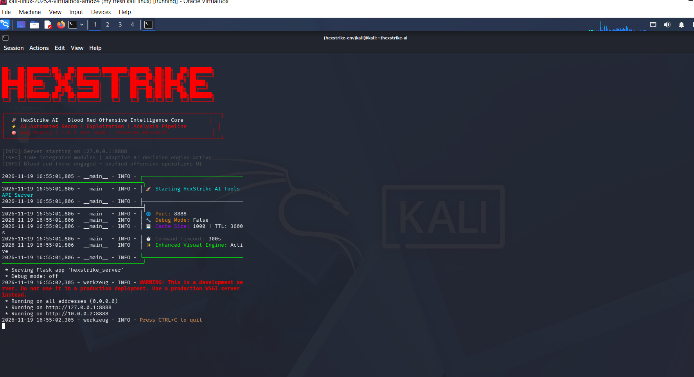](screenshots/env-hexstrike-banner-startup.png)

### 7.2 HexStrike AI server health check

[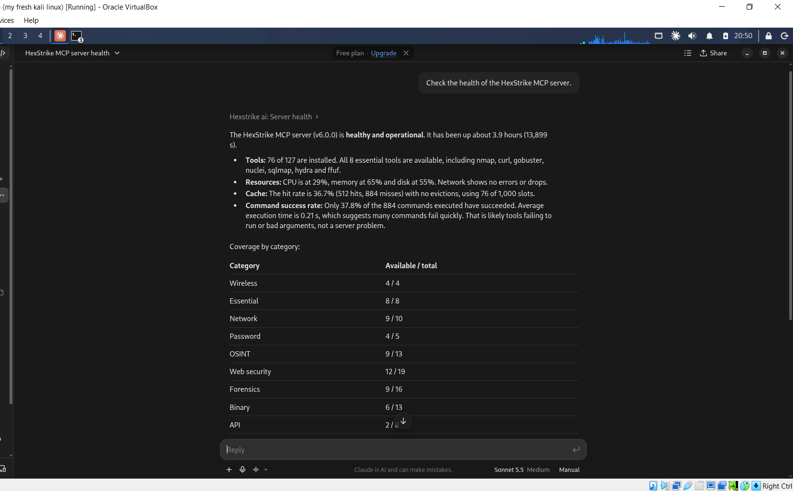](screenshots/env-hexstrike-server-health.png)

### 7.3 John the Ripper version check

[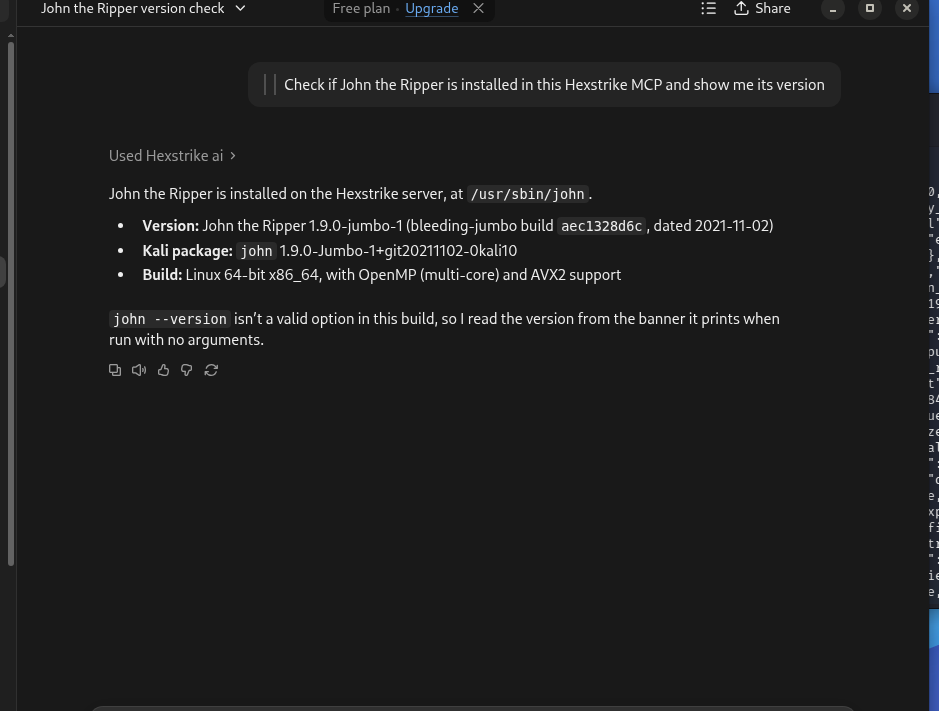](screenshots/env-john-the-ripper-version-check.png)

### 7.4 Troubleshooting note

An early attempt to compute a file hash for one of the lab PDFs via a remote device connection to the Kali VM failed, as the file could not be located at the path given. This was resolved by working with the PDFs directly instead.

[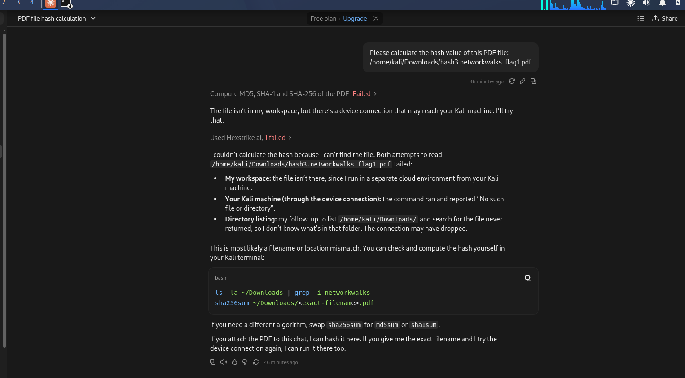](screenshots/env-claude-hash-attempt-via-device.png)

---

# 📑 8. Results Summary

| **#** | **File**             | **Hash prefix**              | **Method**                                    | **Password Recovered** |
| ----- | --------------------- | ----------------------------- | ------------------------------------------------ | ------------------------ |
| 1     | My-Locked-PDF1.pdf     | `$pdf$4*4*128*-1060...`       | Johnny (John the Ripper)                          | `password1`               |
| 2     | My-Locked-PDF2.pdf     | `$pdf$4*4*128*-102...`        | Johnny (John the Ripper)                          | `good-luck`               |
| 3     | My-Locked-PDF3.pdf     | `$pdf$4*4*128*-1028...`       | NetworkWalks Password Cracker + Johnny (verified) | `1qaz2wsx` → 🚩 flag captured |

---

# ⛔ 9. Risk Analysis / Impact

| **#** | **Risk / Finding**                            | **Evidence / Observation**                                   | **⚠️ Potential Impact**                                                                                   | **Risk Level** |
| ----- | ----------------------------------------------- | ---------------------------------------------------------------- | -------------------------------------------------------------------------------------------------------------- | ----------------- |
| 1     | PDF encryption with a top-10 common password     | PDF1's hash cracked instantly using `password1`                   | Encryption provides no real protection when the password is a commonly used word; the file is recoverable in seconds | 🔴 **Critical**    |
| 2     | PDF encryption with a short dictionary phrase     | PDF2's hash cracked using `good-luck`                              | Short, plain-language phrases are covered by small, curated wordlists and fall quickly                            | 🟡 **Medium**      |
| 3     | PDF encryption with a keyboard-walk password      | PDF3's hash cracked using `1qaz2wsx`                                | Keyboard-walk patterns look complex to a human but are predictable and included in standard wordlists              | 🟡 **Medium**      |
| 4     | Hash extractable directly from the encrypted file | NetworkWalks Hash Calculator and OnlineHashCrack both extracted a crackable hash from each PDF without needing the password | Anyone who obtains the encrypted file (e.g. via email, shared drive, or theft) can attempt offline cracking with no rate-limiting and no lockout | 🟡 **Medium**      |

### Risk Rating Key

| Indicator | Severity     |
| --------- | ------------ |
| 🔴         | **Critical** |
| 🟡         | **Medium**   |
| 🟢         | **Low**      |

> ⚠️ **Note: These findings reflect intentionally weak passwords chosen for a controlled educational exercise, not a production system. No real user data, accounts, or third-party systems were involved.**

---

# 🪛 10. Recommendations

## Based on the observations from this exercise, I recommend the following password-security improvements:

1. **Avoid dictionary words and common passwords**
   Never protect sensitive documents with words found in standard wordlists (`password1`, `good-luck`, etc.) — these are the very first entries any cracking tool tries.

2. **Avoid keyboard-walk patterns**
   Passwords like `1qaz2wsx` or `qwerty123` look strong but follow predictable keyboard geometry and are specifically included in cracking wordlists.

3. **Use long, random, unique passphrases**
   A passphrase of several unrelated words, or a randomly generated password of 16+ characters, resists both dictionary and keyboard-walk attacks far better than a single short word or phrase.

4. **Use a password manager**
   Generating and storing strong, unique passwords per document/account removes the temptation to reuse memorable-but-weak passwords.

5. **Treat encrypted files as only as strong as their password**
   PDF/document encryption algorithms themselves (AES-128/256) are strong — the weak point demonstrated in this lab was always the human-chosen password, not the cryptography.

6. **Limit distribution of encrypted files where possible**
   Since a hash can be extracted from an encrypted file without the password, minimizing how widely a sensitive encrypted file is shared reduces the attack surface for offline cracking attempts.

7. **Perform security testing with authorization only**
   All password-cracking exercises should only be performed against one's own files or files with explicit written authorization.

---

# 📜 11. Security Assessment Summary

| **Category**                      | **Status**   |
| ------------------------------------ | --------------- |
| 🔎 Hash Extraction                   | ✔️ Completed    |
| 🌐 Dictionary Attack (online tool)   | ✔️ Completed    |
| 👨🏽‍💻 Offline Cracking (Johnny/JtR)   | ✔️ Completed    |
| 🚩 Flag Capture                      | ✔️ Completed    |
| 💥 Brute-force / Mask Attack         | ⏳ Not Performed |

---

# 🔚 12. Conclusion

During Week 3 of my Cybersecurity & Ethical Hacking internship, I completed authorized educational labs covering PDF hash extraction and offline/online password cracking.

Using the NetworkWalks Hash Calculator, OnlineHashCrack's PDF Hash Extractor, the NetworkWalks Password Cracker, and Johnny (John the Ripper) inside a Kali Linux VM, I extracted crackable hashes from three self-created password-protected PDFs and recovered all three passwords — `password1`, `good-luck`, and `1qaz2wsx` — using nothing more than a 100-word built-in wordlist. Recovering the final password also captured the lab's flag.

This experience reinforced that document encryption is only as strong as the password protecting it: three different password "styles" — a top-10 common word, a short dictionary phrase, and a keyboard-walk pattern — were all cracked in seconds using basic, freely available tools and a small wordlist.

---

## 📌 Project Information

| **Project Details**   | **Information**                              |
| ---------------------- | ------------------------------------------------ |
| 1️⃣ **Program Name**    | Cybersecurity Program at Networkwalks            |
| 2️⃣ **Week**            | 03                                                |
| 3️⃣ **Module**          | W3-PM2 — Password Cracking with NW Tools          |
| 4️⃣ **Project:**       | Authorized Password Recovery / Hash Cracking Lab  |
| 5️⃣ **Repository:**    | GitHub                                            |

---

# 👤 Author

**Oyeru Rachael Emalohi**

**Cybersecurity Intern | Networkwalks | Batch B084D**
# 👤 Author

**Oyeru Rachael Emalohi**

**Cybersecurity Intern | Networkwalks | Batch B084D**

🔗 [LinkedIn](https://www.linkedin.com/in/oyeru-rachael-067a39253)

---
